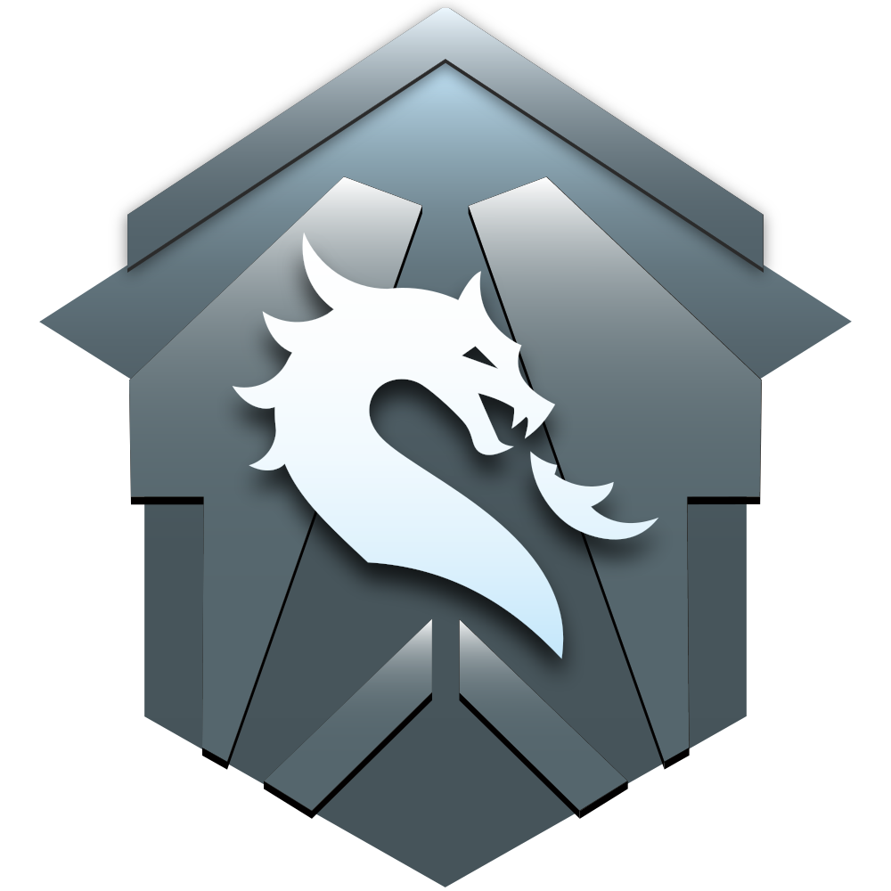

<p align="center">
  
</p>

<h1 align="center">Draconis</h1>

<p align="center">
  A launcher for <strong>Titanfall 2 + <a href="https://northstar.tf">Northstar</a></strong> on macOS, Linux and Windows. Native SwiftUI with Liquid Glass on macOS; the same look on Linux (GTK 4) and Windows (WinUI 3) through SwiftCrossUI.
</p>

<p align="center">
  
  
  
  
  
  
</p>

---

On macOS Draconis runs the game through **CrossOver** or **Draconis Wine** (its own open-source Wine, no CrossOver needed); the onboarding wizard sets up a bottle end to end. On Linux it finds Titanfall 2 in Steam (native, Flatpak or Snap), Heroic or a folder you pick, and starts it through Steam or through Proton / GE-Proton / Wine with umu-launcher. On Windows it runs the game directly.

## ⚠️ Opening Draconis for the first time

Draconis is **not notarised by Apple**, so the first time you launch it macOS will refuse with one of these:

> *"Draconis" cannot be opened because Apple cannot check it for malicious software.*

> *"Draconis" is damaged and can't be opened. You should move it to the Trash.*

Normal for any open-source macOS app without an Apple Developer ID. On **macOS Tahoe 26.6 and later**, the Finder dialog for a non-notarised app often only offers **Move to Trash** — don't pick that. Use the Terminal route instead; it works on every macOS version.

### Option A — Terminal *(recommended)*

After dragging Draconis into Applications, run:

```bash
xattr -dr com.apple.quarantine /Applications/Draconis.app
```

Then launch normally. This clears the "downloaded from the internet" flag on this one app only; Gatekeeper stays on for everything else. In-app updates are downloaded without that flag, so you only need to do this once.

### Option B — System Settings *(older macOS)*

1. Try to launch Draconis normally (it gets blocked).
2. Open **System Settings → Privacy & Security**.
3. Scroll to the **Security** section — if there's a line *"Draconis was blocked from use…"* with an **Open Anyway** button, click it and confirm.

If there's no **Open Anyway** button, use Option A.

---

## Features

- **One-click launch** for both Northstar and vanilla Titanfall 2.
- **Guided onboarding wizard** that picks up where you left off — detects existing bottles, lets you reuse them or create new ones, and walks you through whichever step is missing.
- **Install sources** (macOS): EA app, Steam, Epic Games (through the EA app, no Epic launcher) and, experimentally, [Maxima-Draconis](https://github.com/AA-EION/Maxima-Draconis).
- **Runners** (Linux): Steam's own Proton, GE-Proton (one-click download), Proton builds from Heroic, Lutris and Bottles, system Wine. Draconis-made prefixes live in Draconis's data folder, never `~/.wine`.
- **Northstar auto-updater** on every launch.
- **Thunderstore mod browser** with install / enable / disable / uninstall.
- **Server browser** backed by the Northstar masterserver.
- **Native Liquid Glass UI** using macOS Tahoe's `.glassEffect()`; on Linux and Windows the same layout with glass cards, GTK blur (4.22+) or Mica.

## Requirements

- **macOS:** Tahoe (26) or later. [CrossOver](https://www.codeweavers.com/crossover) is optional: Draconis Wine needs macOS 15 and works without it.
- **Linux:** x86_64 with GTK 4. AppImage, deb, rpm, Flatpak and tar.gz builds are on the releases page. Steam copies need nothing else; other copies need Proton (GE-Proton can be downloaded from Settings) or Wine.
- **Windows:** 10 or 11 (x64) and the [Windows App SDK runtime](https://aka.ms/windowsappsdk/1.5/latest/windowsappruntimeinstall-x64.exe).
- A legal copy of Titanfall 2 on any of:
  - **Steam**
  - **EA app**
  - **EA library directly** — purchased on EA, or your Steam/Epic account linked + synced at least once. Draconis can download the game itself via Maxima.
  - **Epic Games** *(through the EA app)*

## How it works (macOS)

The wizard adapts to what's already on your Mac:

1. **No bottles yet** → pick an install source → Draconis creates a fresh `win10_64` bottle, installs the launcher you picked, and waits for Titanfall 2 to arrive in it.
2. **Existing bottle detected** → choose to reuse it or create a new one. If you reuse, Draconis scans what's inside and skips ahead to the first missing piece.
3. **Maxima route specifically** → Draconis installs Maxima into the bottle, then drives the OAuth login + game download from inside Maxima's UI. You only have to sign into EA in your browser. Draconis watches the install and advances when it's truly done.

Once the bottle is ready, the **Play** screen detects whether Northstar is installed and lets you launch either mode. Launches go through CrossOver's `cxstart` or Draconis Wine, with the bottle's own environment.

## Steam CEG fix

Steam ships Titanfall 2's `Titanfall2.exe` and `Titanfall2_trial.exe` signed with **CEG** (Custom Executable Generation) per-user DRM. On macOS/CrossOver the DRM check fails and the game shows:

> *Engine Error: File corruption detected*

Nothing's actually corrupted — the DRM just can't verify itself under older Wine builds. Recent CrossOver versions run Steam copies without it, and Proton on Linux never needed it. CEG only touches those two binaries; every other file in the Steam install matches the EA original.

Draconis fixes it by replacing just those two files with EA's originals via Maxima (~3 MB download, under a minute). Your Steam library entry, save games, Northstar mods, and the rest of the install stay untouched. It's only needed with an older CrossOver: pick Maxima's "full replace" role for the bottle and the wizard runs it.

## Maxima authentication

[Maxima-Draconis](https://github.com/AA-EION/Maxima-Draconis) is an open-source replacement for EA Desktop / Origin that runs inside the CrossOver bottle. It's experimental and opt-in; the EA app is the default. Draconis bundles its host-side helper (`MaximaHelper.app`) and downloads the bottle-side installer (`MaximaSetup.exe`) on demand.

When Maxima is installed in a bottle, Draconis routes launches through it for EA authentication — no need for EA Desktop to be open. The installed Maxima version is tracked; an **Update Maxima** button appears in Settings when a newer release is published.

If your Titanfall 2 EA license isn't linked to your EA account (Steam-only owners), Maxima can't see the game in your library. Linking accounts at [ea.com](https://www.ea.com) resolves this — takes about 30 seconds.

## Privacy & error reporting

On first launch Draconis presents a **Privacy & Data Notice** you must accept before the app opens. This acceptance is stored in `~/Library/Preferences/org.draconis.launcher.plist` and is remembered permanently — you will not be asked again unless you delete that file or run `defaults delete org.draconis.launcher`.

**What's collected:**

- Crash reports and handled errors via [Sentry](https://sentry.io/privacy/) (EU servers)
- Bottle state (which components are installed), app version, CrossOver availability
- Last 60 lines of console output when you submit a bug report (home-directory path replaced with `~`)
- Optional: display name and contact handle you enter yourself in a bug report

**Third-party services — each governs their own data:**

| Service | What it handles | Privacy policy |
|---|---|---|
| Sentry | Crash / error telemetry and bug feedback | [sentry.io/privacy](https://sentry.io/privacy/) |
| GitHub | Source code, releases, public issues | [GitHub Privacy Statement](https://docs.github.com/en/site-policy/privacy-policies/github-general-privacy-statement) |
| Electronic Arts / Maxima | EA authentication and game downloads (if using Maxima) | [ea.com/legal/privacy-policy](https://www.ea.com/legal/privacy-policy) |
| Northstar master server | IP visibility when connecting to community servers | [northstar.tf](https://northstar.tf) |

Draconis does not run its own remote database. To withdraw consent, delete your preferences (`defaults delete org.draconis.launcher`) — the notice will reappear on next launch.

**Reporting a bug:** use **Help → Report a Bug…** (⌘⌥B) or the **Report a Bug** button in Settings → About. Your last 60 console lines and bottle state are bundled automatically; description is required, name and contact are optional.

## Building

```bash
# Generate the Xcode project + open it
./bootstrap.sh --open

# Or build from the command line
xcodebuild -project Draconis.xcodeproj \
           -scheme Draconis \
           -configuration Release \
           -derivedDataPath build
```

Output: `build/Build/Products/Release/Draconis.app`.

Linux and Windows (Swift 6.4; GTK 4 dev headers on Linux):

```bash
swift run --package-path CrossPlatform            # run the app
bash Scripts/package-linux.sh 0.13.0 [--flatpak]  # AppImage, deb, rpm, tar.gz, Flatpak
pwsh Scripts/package-windows.ps1 -Version 0.13.0  # Windows zip
```
 See [BUILD.md](./BUILD.md) for the full build + signing + notarisation walkthrough, and [CLAUDE.md](./CLAUDE.md) for the architecture deep dive.

## Contributors

<a href="https://github.com/AA-EION/Draconis/graphs/contributors">
  
</a>

Made with [contrib.rocks](https://contrib.rocks).

## Credits

- The Northstar team at [R2Northstar](https://github.com/R2Northstar)
- [Viper](https://github.com/0neGal/viper) by 0neGal — the original launcher that inspired Draconis
- [CodeWeavers](https://www.codeweavers.com/) for CrossOver
- [SwiftCrossUI](https://github.com/moreSwift/swift-cross-ui), [umu-launcher](https://github.com/Open-Wine-Components/umu-launcher) and [GE-Proton](https://github.com/GloriousEggroll/proton-ge-custom)
- [Maxima-Draconis](https://github.com/AA-EION/Maxima-Draconis) for EA authentication

## License

GPL-3.0-or-later. Draconis is a derivative work in spirit — but not in code — of the Viper launcher, which carries the same licence. Bundled and downloaded third-party components are listed in [THIRD-PARTY-NOTICES.md](./THIRD-PARTY-NOTICES.md).
